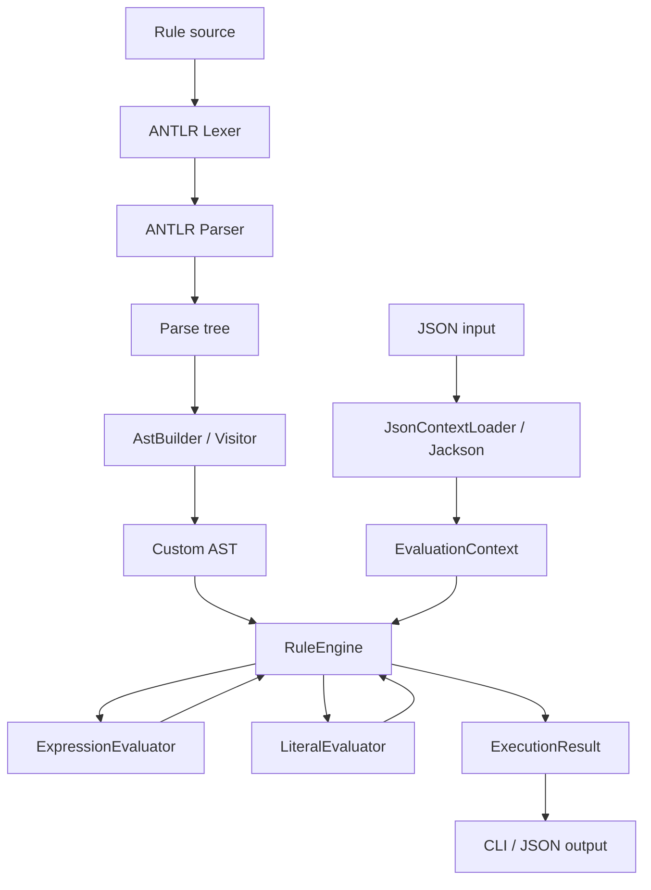
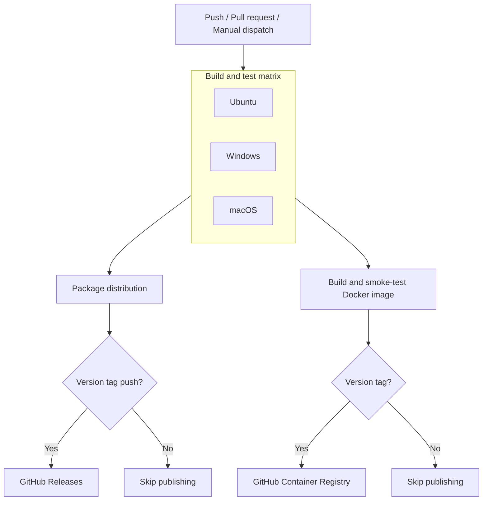

## Rule Engine

[](https://github.com/ab-sandbox/mephi-rule-engine/actions/workflows/ci-cd.yml)


A lightweight DSL-based business rule engine built with Java 21 and ANTLR4, featuring a custom abstract syntax tree, an
expression interpreter, and an automated cross-platform CI/CD pipeline.

### Overview

Rule Engine separates business decision logic from application code. Rules are expressed in a dedicated textual language
and evaluated against structured JSON data to produce a set of decisions, such as discounts, delivery costs, customer
classifications, and order approval flags.

The project combines language implementation with software delivery automation: from grammar generation and static
analysis to verified distributions and container images.

### Features

- Declarative, named business rules with conditional assignments.
- Nested property access and numeric, string, and boolean literals.
- Logical expressions with operator precedence, grouping, and short-circuit evaluation.
- Custom AST based on Java records and sealed interfaces.
- Deterministic rule execution against an isolated input context.
- Structured JSON output and explicit CLI exit codes.
- Executable fat JAR and Docker-based execution.
- Cross-platform CI, automated quality gates, and tag-driven release publishing.

### Quick Start

#### Build from source

Requirements: JDK 21 and Maven. Docker is optional.

```bash
git clone https://github.com/ab-sandbox/mephi-rule-engine.git
cd mephi-rule-engine
mvn clean verify
```

Run the executable JAR:

```bash
java -jar target/rule-engine.jar examples/discount.rules examples/context.json
```

Display usage information:

```bash
java -jar target/rule-engine.jar --help
```

#### Run with Docker

Build the JAR first, then build and run the image:

```bash
mvn clean verify
docker build -t rule-engine:local .
docker run --rm rule-engine:local
```

The default container command evaluates the bundled example. To use external rule and context files (POSIX shell):

```bash
docker run --rm \
  -v "$PWD/examples:/data:ro" \
  rule-engine:local \
  /data/discount.rules /data/context.json
```

The container uses Eclipse Temurin 21 JRE, runs as a non-root user, and consumes the prebuilt JAR rather than compiling
Java inside the image.

### Rule Language

A program consists of one or more named rules. Each rule contains a condition and a single assignment.

```text
rule "Standard discount" {
    when customer.age >= 18
    then discount = 5
}

rule "Premium discount" {
    when customer.age >= 18
        and customer.premium == true
    then discount = 15
}

rule "Free delivery" {
    when order.total >= 5000
    then delivery = 0
}
```

A corresponding JSON context:

```json
{
  "customer": {
    "age": 25,
    "premium": true
  },
  "order": {
    "total": 15000.99
  }
}
```

Evaluating these three rules produces:

```json
{
  "matchedRules": [
    "Standard discount",
    "Premium discount",
    "Free delivery"
  ],
  "values": {
    "discount": 15,
    "delivery": 0
  }
}
```

The bundled [rules](examples/discount.rules) and [context](examples/context.json) additionally demonstrate customer
status and order approval.

#### Language reference

| Construct                     | Syntax / behavior                                       |
|-------------------------------|---------------------------------------------------------|
| Rule                          | `rule "Name" { when condition then assignment }`        |
| Property                      | `customer.address.city`                                 |
| Numeric comparison            | `==`, `!=`, `>`, `>=`, `<`, `<=`                        |
| String and boolean comparison | `==`, `!=`                                              |
| Logical operators             | `not`, `and`, `or` (highest to lowest precedence)       |
| Grouping                      | `(condition)`                                           |
| Literals                      | Decimal numbers, double-quoted strings, `true`, `false` |
| Assignment                    | `discount = 15`                                         |
| Comment                       | `// single-line comment`                                |

Strings support escaped double quotes and backslashes. Comparisons are type-strict; unsupported comparisons, missing
properties, and incompatible values raise evaluation errors.

#### Execution semantics

- Rules are evaluated once, in declaration order.
- Every matching rule contributes its name and assignment to the result.
- If multiple matching rules assign the same property, the last assignment wins.
- Assignments do not modify the input context or influence subsequent conditions.
- Dotted assignment paths are represented as flat output keys.
- Evaluation stops on an error; there is no implicit type coercion or rule chaining.

### Application Architecture



| Component | Responsibility                                                       |
|-----------|----------------------------------------------------------------------|
| `grammar` | Separate ANTLR lexer and parser grammars                             |
| `parser`  | Syntax diagnostics, parsing facade, parse-tree-to-AST transformation |
| `ast`     | Immutable language model using records and sealed interfaces         |
| `runtime` | Context resolution, expression evaluation, rule execution            |
| `json`    | JSON deserialization and numeric precision preservation              |
| `cli`     | File-based input, JSON output, error reporting and exit codes        |

#### Design decisions

- **Parser-independent runtime:** ANTLR types remain outside the AST and evaluation layers. The generated parse tree is
  transformed through the Visitor pattern.
- **Explicit language model:** sealed interfaces and pattern matching switches provide exhaustive handling of expression
  and literal variants.
- **Decimal arithmetic:** numeric comparisons use `BigDecimal`; JSON integers and decimals are loaded using `BigInteger`
  and `BigDecimal` respectively.
- **Context isolation:** nested maps and lists are recursively copied into unmodifiable collections, preventing
  mutations of JSON-compatible input structures from affecting execution.
- **Separate results:** output values and matched rule names are collected independently of the input context.
- **Reusable program:** parsed rules can be evaluated against different contexts without parsing the source again.
- **Deliberate scope:** a single-pass interpreter, not a forward-chaining inference engine; no rule agenda, priorities,
  or working-memory updates.

#### CLI exit codes

| Code | Meaning                      |
|------|------------------------------|
| `0`  | Successful execution or help |
| `2`  | Invalid arguments or path    |
| `3`  | Rule syntax error            |
| `4`  | Rule evaluation error        |
| `5`  | I/O or JSON processing error |

Successful execution writes JSON to standard output; diagnostics are sent to standard error.

### Project Structure

```text
mephi-rule-engine/
├── .github/
│   ├── actions/build-summary/
│   │   ├── action.yml
│   │   └── summary.py
│   └── workflows/
│       ├── ci-cd.yml
│       ├── build.yml
│       ├── distribution.yml
│       ├── release.yml
│       └── docker.yml
├── config/
│   ├── checkstyle/checkstyle.xml
│   └── spotbugs/exclude.xml
├── examples/
│   ├── discount.rules
│   └── context.json
├── src/
│   ├── main/
│   │   ├── antlr4/dev/abykov/rules/grammar/
│   │   └── java/dev/abykov/rules/
│   │       ├── ast/
│   │       ├── cli/
│   │       ├── json/
│   │       ├── parser/
│   │       └── runtime/
│   └── test/java/dev/abykov/rules/
├── .dockerignore
├── Dockerfile
└── pom.xml
```

### CI/CD Pipeline

The [main workflow](.github/workflows/ci-cd.yml) orchestrates four reusable workflows using GitHub-hosted runners.



#### Workflow responsibilities

| Workflow                                                 | Responsibility                                                                                 |
|----------------------------------------------------------|------------------------------------------------------------------------------------------------|
| [`ci-cd.yml`](.github/workflows/ci-cd.yml)               | Triggers, job dependencies, permissions, concurrency control                                   |
| [`build.yml`](.github/workflows/build.yml)               | OS matrix, Maven cache, build, tests, quality gates, JAR smoke tests, reports                  |
| [`distribution.yml`](.github/workflows/distribution.yml) | Reuse Ubuntu JAR, package examples, verify checksums and extracted distribution                |
| [`docker.yml`](.github/workflows/docker.yml)             | Reuse Ubuntu JAR, Buildx, GitHub Actions layer cache, smoke tests, conditional GHCR publishing |
| [`release.yml`](.github/workflows/release.yml)           | Verify archive checksum and publish release assets using GitHub CLI                            |

The pipeline runs on pushes to `main`, pushes of `v*` tags, pull requests targeting `main`, and manual dispatch.
Superseded runs for the same workflow and ref are cancelled. Distribution and Docker jobs run independently after the
entire build matrix succeeds.

The packaging and container stages reuse the tested Ubuntu JAR without recompiling the application. The container is
tested before publishing that same local image. GitHub Releases and GHCR are independent publishing paths, not an atomic
deployment transaction.

#### Quality gates

All quality checks are integrated into the Maven lifecycle and executed by `mvn clean verify`.

| Tool       | Purpose                  | Policy                                                    |
|------------|--------------------------|-----------------------------------------------------------|
| JUnit 5    | Automated tests          | Tests must pass                                           |
| JaCoCo     | Code coverage            | At least 90% line and 80% branch coverage                 |
| Checkstyle | Source code style        | Fail on configured violations                             |
| SpotBugs   | Static bytecode analysis | Maximum effort, medium threshold, fail on detected issues |

ANTLR-generated code is excluded from JaCoCo and SpotBugs; Checkstyle targets handwritten main and test sources.

The [custom composite action](.github/actions/build-summary/action.yml) runs
a [Python script](.github/actions/build-summary/summary.py) that aggregates test results, coverage, Checkstyle and
SpotBugs findings, environment information, Maven cache hits, and artifact size into GitHub job summaries.

#### Testing and reports

The current implementation contains 92 JUnit tests across nine test classes, covering grammar, AST, parser diagnostics,
context isolation, evaluation, rule execution, JSON loading, and CLI behavior.

In addition, CI smoke-tests executable JARs on all three operating systems, the extracted distribution, and the Docker
image. Smoke tests invoke the bundled example and help command.

Local reports are available under:

| Report     | Location                        |
|------------|---------------------------------|
| Surefire   | `target/surefire-reports/`      |
| JaCoCo     | `target/site/jacoco/index.html` |
| Checkstyle | `target/checkstyle-result.xml`  |
| SpotBugs   | `target/spotbugsXml.xml`        |

The latest execution results are available in [GitHub Actions](https://github.com/ab-sandbox/mephi-rule-engine/actions).

#### Build artifacts

Successful runs provide executable JARs and quality reports for Ubuntu, Windows, and macOS, a verified ZIP distribution,
and a Docker build record. Explicitly uploaded build artifacts have a 14-day retention period.

The distribution contains:

```text
rule-engine.zip
├── rule-engine.jar
├── SHA256SUMS
└── examples/
    ├── discount.rules
    └── context.json
```

A separate `rule-engine.zip.sha256` file verifies the archive itself. On systems with GNU coreutils:

```bash
sha256sum -c rule-engine.zip.sha256
unzip rule-engine.zip -d rule-engine
cd rule-engine
sha256sum -c SHA256SUMS
java -jar rule-engine.jar examples/discount.rules examples/context.json
```

### Release Process

Release publishing is configured to run when a version tag is pushed. For example, a maintainer can initiate version
`v1.0.0` with:

```bash
git tag -a v1.0.0 -m "Release v1.0.0"
git push origin v1.0.0
```

After successful verification, the publishing workflows are configured to:

- Attach `rule-engine.zip` and `rule-engine.zip.sha256` to
  a [GitHub release](https://github.com/ab-sandbox/mephi-rule-engine/releases).
- Publish the smoke-tested Docker image to `ghcr.io/ab-sandbox/mephi-rule-engine` with tags generated from the version
  and commit metadata.

Once version `1.0.0` is published and the package is publicly accessible, it can be run using:

```bash
docker run --rm ghcr.io/ab-sandbox/mephi-rule-engine:1.0.0
```

Publishing uses the built-in `GITHUB_TOKEN`, with write permissions scoped to the relevant publishing jobs. No personal
access token or self-hosted runner is required. The current container workflow builds for Linux AMD64.

### Technology Stack

| Area                    | Technologies                                                       |
|-------------------------|--------------------------------------------------------------------|
| Language and runtime    | Java 21, Eclipse Temurin                                           |
| Language implementation | ANTLR 4.13.2, Visitor, custom AST                                  |
| JSON                    | Jackson 2.18.3                                                     |
| Build and packaging     | Maven, Maven Shade Plugin                                          |
| Testing and quality     | JUnit 5, JaCoCo, Checkstyle, SpotBugs                              |
| Automation              | GitHub Actions, reusable workflows, composite actions, Python 3.12 |
| Containerization        | Docker, Buildx, BuildKit, GHCR                                     |

### Educational Context

Developed as part of the Software Development master's program at National Research Nuclear University MEPhI, for the
course on software development pipelines.

The project demonstrates the design of a domain-specific language and its integration into an automated software build,
verification, packaging, and delivery process.
